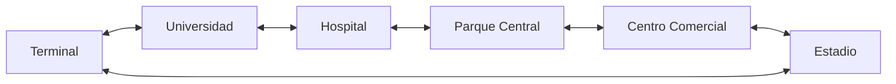

# Taller: Listas Circulares Dobles — Ruta Circular de Bus

**Asignatura:** Estructuras de Datos — Universidad Cooperativa de Colombia
**Autor:** Santiago425

## 1. Caso de estudio

Una empresa de transporte maneja una **ruta circular universitaria**: el bus sale de la terminal, pasa por varias paradas (Universidad, Hospital, Parque Central, Centro Comercial, Estadio) y al llegar a la última vuelve a la terminal para empezar otra vuelta, sin detenerse nunca.

El sistema permite:

- Agregar paradas al **inicio** (nueva terminal), al **final** o **en medio** (después de otra parada).
- **Eliminar** paradas que se cierran.
- **Buscar** una parada y ver sus paradas vecinas.
- **Recorrer** la ruta en ambos sentidos desde donde está el bus.
- **Avanzar** y **retroceder** el bus, contando vueltas completas y minutos recorridos.

## 2. ¿Qué es una lista circular doble?

Es una lista enlazada en la que cada elemento guarda **dos enlaces**: uno al elemento de adelante y otro al de atrás. Además es **circular**: el último elemento apunta al primero y el primero apunta al último, así que no existe un final con `None`.

En este proyecto:

| Concepto de la estructura | En el caso de estudio |
|---|---|
| Nodo | `BusStop` (una parada) |
| Enlace hacia adelante | `stop_ahead` (la parada a la que va el bus) |
| Enlace hacia atrás | `stop_behind` (la parada de la que viene) |
| Primer elemento | `terminal` |
| Lista | `CircularRoute` |

Con una sola parada, sus dos enlaces apuntan a sí misma. Mientras haya paradas en la ruta **ningún enlace queda en `None`**.

## 3. Diagrama



```
        stop_ahead →                stop_ahead →
  ┌──────────┐      ┌─────────────┐      ┌──────────┐
  │ Terminal │ ⇄    │ Universidad │ ⇄    │ Hospital │ ⇄ ...
  └──────────┘      └─────────────┘      └──────────┘
        ↑   ← stop_behind                       │
        └──────────── Estadio ⇄ ... ⇄ ──────────┘
```

Insertar una parada en medio (después de `Universidad`):

```
Antes:   Universidad ⇄ Hospital
Después: Universidad ⇄ Biblioteca ⇄ Hospital
```

Solo se cambian cuatro enlaces: los dos de la nueva parada, el `stop_ahead` de Universidad y el `stop_behind` de Hospital.

## 4. ¿Por qué aplica a este caso?

- **Es circular por naturaleza:** después de la última parada el bus vuelve a la terminal. La estructura lo representa sin condiciones especiales.
- **Se recorre en dos sentidos:** el bus puede avanzar o retroceder, y en cualquier parada se conoce la de adelante y la de atrás en tiempo constante.
- **Las paradas cambian:** abrir o cerrar una parada solo reacomoda los enlaces de sus vecinas, sin mover las demás.

## 5. Ventajas

- Avanzar y retroceder es O(1).
- Insertar o eliminar teniendo la parada de referencia es O(1).
- No hay casos especiales de "fin de lista": el recorrido nunca se cae por un `None`.
- Se puede empezar a recorrer desde cualquier parada (por ejemplo, desde donde está el bus).

## 6. Desventajas

- Cada parada guarda dos enlaces, así que usa más memoria que una lista simple.
- Buscar por nombre es O(n): hay que recorrer la ruta.
- Hay que controlar los recorridos con el tamaño de la lista; si no, un ciclo nunca termina.
- Es fácil dañar la estructura si se olvida actualizar alguno de los enlaces al insertar o eliminar.

## 7. Complejidad

| Operación | Método | Complejidad |
|---|---|---|
| Insertar al inicio | `insert_at_start` | O(1)* |
| Insertar al final | `insert_at_end` | O(1)* |
| Insertar en medio | `insert_after` | O(n) por la búsqueda, O(1) el enlace |
| Eliminar | `remove` | O(n) por la búsqueda, O(1) el desenlace |
| Buscar | `find` | O(n) |
| Recorrer adelante / atrás | `traverse_ahead` / `traverse_behind` | O(n) |
| Avanzar / retroceder el bus | `drive_ahead` / `drive_behind` | O(1) |

\* La validación de nombre repetido recorre la ruta, así que en la práctica la inserción completa es O(n).

## 8. Estructura del proyecto

```
├── transit/
│   ├── bus_stop.py        # BusStop: la parada (nodo)
│   ├── circular_route.py  # CircularRoute: la lista circular doble
│   ├── bus_line.py        # BusLine: el bus moviéndose sobre la ruta
│   └── errors.py          # Errores propios con mensajes en español
├── tests/                 # Pruebas unitarias
├── templates/ y static/   # Frontend web
├── console.py             # Menú por consola
├── app.py                 # Servidor web (Flask)
└── requirements.txt
```

## 9. Instrucciones para ejecutarlo

Requisitos: Python 3.10 o superior.

```bash
git clone https://github.com/Santiago425/Taller_Listas_Circulares_DOBLES..git
cd Taller_Listas_Circulares_DOBLES.
python -m venv .venv
.venv\Scripts\activate        # Windows
source .venv/bin/activate     # Linux / Mac
pip install -r requirements.txt
```

**Menú por consola:**

```bash
python console.py
```

**Interfaz web:**

```bash
python app.py
```

Luego abrir http://127.0.0.1:5000 en el navegador.

**Pruebas:**

```bash
python -m unittest discover -s tests -v
```

## 10. Validaciones

- El nombre de la parada es obligatorio y tiene máximo 30 caracteres.
- No se permiten dos paradas con el mismo nombre (sin importar mayúsculas).
- Los minutos deben ser un entero entre 1 y 120.
- No se puede mover el bus, buscar ni eliminar en una ruta vacía.
- Insertar "después de" exige que la parada de referencia exista.

## 11. Ejemplo de uso por consola

```
Elige una opción: 4
¿Después de qué parada?: Hospital
Nombre de la nueva parada: Farmacia
Minutos hasta la parada que sigue: 2

Parada 'Farmacia' agregada.
```

Al recorrer hacia adelante desde la terminal, la ruta queda:
`Terminal → Universidad → Hospital → Farmacia → Parque Central → Centro Comercial → Estadio → Terminal`
